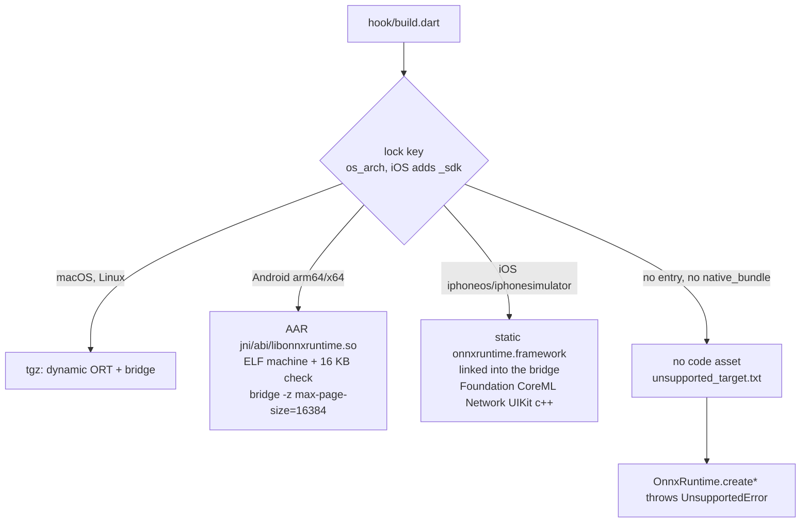

# 0.3.0 acceptance — mobile CPU delivery — 2026-11-12

0.3.0 removes the build failure that stopped cross-platform Flutter apps from
depending on lib_onnx ([#1](https://github.com/gsmlg-app/lib_onnx/issues/1)):
before this release the hook threw `UnsupportedError` for every iOS, Android and
Windows build, so an app that also targets those platforms could not take the
dependency at all.

The supported claim is **CPU inference** with bridge ABI 2 on:

| Target | ORT | Pinned official input | Device acceptance |
|---|---|---|---|
| `macos_arm64` | 1.31.1 | `onnxruntime-osx-arm64-1.31.1.tgz` | Apple M1 Max host (unchanged route, re-verified) |
| `android_arm64` | 1.31.1 | Maven Central `onnxruntime-android-1.31.1.aar` | Pixel Fold, Android 17, arm64-v8a |
| `ios_arm64` (iphoneos) | 1.30.0 | `pod-archive-onnxruntime-c-1.30.0.zip` | iPhone 18 Pro (iPhone19,2), iOS 27.2.1 |

Compiled and packaged but not run on a device: `android_x64` (same AAR) and the
iOS simulator slices `ios_arm64`/`ios_x64` (`iphonesimulator`); no simulator
runtime is installed on the verification host. CoreML, NNAPI and XNNPACK are
compiled into the official mobile archives and listed by
`GetAvailableProviders`; registration is not hardware acceptance, and
`acceleration_claimed` remains false everywhere. QNN/HTP still requires a
verified `native_bundle`; the official AAR does not contain the QNN EP.

## Design

- **Pinned inputs only.** Each target names an exact archive, URL and SHA-256
  in `native/ort_artifacts.json`; the hook verifies the digest before use and
  `offline`/`ort_cache`/`ort_archive` work as before. Zip-based archives
  (`.zip`, `.aar`) are unpacked with `unzip`, falling back to `tar`.
- **iOS ORT version.** Microsoft has not published an iOS archive for 1.31.1;
  the newest official `onnxruntime-c` archive is 1.30.0. iOS therefore links
  1.30.0 and compiles the bridge against that archive's own headers
  (`ORT_API_VERSION` 30). Every C API function the bridge calls predates 1.30.
  `NativeLibrary.expectedOrtVersion` is 1.30.0 on iOS and 1.31.1 elsewhere, so
  a mismatched runtime is still rejected. The official archive's minimum is
  iOS 15.1.
- **Static linking on iOS.** The official iOS framework is a static archive, so
  the bridge is the only code asset; Flutter wraps it as
  `lib_onnx_bridge.framework`. The bridge links the system frameworks the
  archive needs (Foundation, CoreML, Network, UIKit, libc++).
- **Unsupported targets build.** With no pinned artifact and no
  `native_bundle`, the hook produces no code asset instead of failing the
  consumer build. Loading the runtime then throws `UnsupportedError` naming the
  platform. This covers Windows, Android armeabi-v7a, macOS x64 and anything
  else without an entry.

Alternatives rejected: shipping one ORT version per release by waiting for an
iOS 1.31.1 archive (blocks Android and iOS indefinitely); building ORT for iOS
from source (an unpinned, unofficial runtime); an Android QNN-only route (needs
non-redistributable vendor libraries).

## Verification

Host: MacBook Pro / MacBookPro18,4, Apple M1 Max, macOS 27.0.1, Xcode 27.2,
Dart 3.13.7, Flutter 3.47.9. Source fingerprint
`a6e5cd8fedd020ec686c063a7f35cc5cbeeb8cfecc1835a27ca5544d372987a8`.

| Check | Observed result |
|---|---|
| Formatting, core and example analyzers | Passed |
| Dart tests | 60 passed, including real ORT inference, lifecycle/stress cases and the platform ORT pin check |
| Distribution and Qwen profile tooling | 11 + 3 passed |
| Hook input checks | 8 passed: corrupt/missing archives and old bundles rejected; iOS device, iOS simulator and Android select their pinned archives; Windows x64 and Android arm build without code assets |
| Native ASan/UBSan, TSan, dequeue-latch lifecycle | Passed |
| Unsupported runtime | `OnnxRuntime.create()` and `createAsync()` throw `UnsupportedError` when no asset exists |
| Clean archive consumers (exact `dart pub publish --to-archive` payload, local hosted repository, fresh pub cache, pinned archives offline) | macOS JIT, compiled CLI and Flutter release; Android release APK on the Pixel Fold; signed iOS release app on the iPhone: all returned the Identity fixture `[1.0, 2.0, 3.0, 4.0]` on CPU (ORT 1.31.1, 1.31.1, 1.30.0) |
| Android release APK | arm64-v8a `libonnxruntime.so`, `liblib_onnx_bridge.so`, `libflutter.so`, `libapp.so` pass the ELF 16 KB audit; armeabi-v7a builds without lib_onnx assets |
| EmbeddingGemma 2 (q4) on macOS, Dart tokenizer + lib_onnx | Token ids equal to HF `tokenizers`; embeddings within 1.3e-8 of Python ORT; see the model evidence |
| `python3 tools/release_gate.py --version 0.3.0` | Passed |

Evidence: [software commands](evidence/0.3.0-software.log),
[consumer receipt](evidence/0.3.0-consumer.json) and
[commands](evidence/0.3.0-consumer.log), [Android device](evidence/0.3.0-android-arm64.log),
[iOS device](evidence/0.3.0-ios-arm64.log),
[unsupported target](evidence/0.3.0-unsupported-target.log),
[EmbeddingGemma 2 parity](evidence/0.3.0-embeddinggemma2-macos.log).

## Limits

- CPU only. CoreML/NNAPI/XNNPACK hardware use was not observed; QNN/HTP and Qwen
  acceptance remain open.
- The Pixel Fold kernel uses 4 KB pages; 16 KB compatibility is established by
  the ELF audit, not by running on a 16 KB kernel.
- iOS simulator and Android x86_64 were compiled and packaged only.
- The first build per machine downloads the pinned archives (iOS 64 MB,
  Android 55 MB). The download honours the standard proxy variables; use
  `ort_cache` with pre-fetched archives where the network is slow.

## 0.3.1 re-verification — 2026-11-12

0.3.1 only replaces the exact dependency pins with caret ranges (bridge
version string 0.3.1; native code and pinned ORT inputs unchanged). It was
re-verified with the newer resolved hook toolchain (`crypto` 3.0.8,
`code_assets` 2.2.0, `native_toolchain_c` 0.19.6): the full software suite
([log](evidence/0.3.1-software.log)) and the clean hosted-archive consumers on
the same macOS host, Pixel Fold and iPhone 18 Pro all passed with CPU output
`[1.0, 2.0, 3.0, 4.0]` ([receipt](evidence/0.3.1-consumer.json),
[commands](evidence/0.3.1-consumer.log)).
